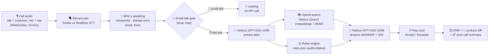

# 🎯 CLOSER: Contextual Live-call Optimization for Sales, Engagement & Retrieval

🌐 **Live app: https://closer-stanford-hack.replit.app/**

> 🏆 Built at the **Future of Work Hackathon: Building from the Farm** @ Stanford University 🌲 #SFTechWeek
> 📅 October 9–10, 2026

> 🎯 **Track 4: Sales Without "Let Me Get Back to You"**
>
> High-value B2B deals ($100k+ ARR) stall the moment a customer asks for custom terms, compliance exceptions, or
> non-standard pricing. How can you unify pricing models, legal guardrails, and product capabilities scattered across
> enterprise tools into a single vectorized "Company Brain" that can be queried in sub-500ms during a live
> conversation? Can that voice agent listen to a live sales call, evaluate customer demands against that Company
> Brain in real time, negotiate trade-offs within pre-approved limits, and update the CRM/contract on the fly?

A live sales copilot 🎧 that listens to a call, works out who is speaking, stays quiet through greetings and small
talk, and when the customer asks for something or raises a concern it checks the Company Brain 🧠 (docs +
deterministic rules) and shows the rep an approved answer and a line to say ⚡ in well under a second. Accepted terms
update the CRM and contract 📝; the call ends with a post-call summary 📋.

---

## 😩 The problem

A customer asks a hard question mid-call: a discount, HIPAA, contract terms, an integration. The rep doesn't know the
answer, or what they're allowed to say, so they promise a follow-up:

> 🧑‍💼 **Customer:** Can you do 20% off if we sign for 3 years?
> 🙋 **Rep:** Let me check with my manager and get back to you.
> 🧑‍💼 **Customer:** And do you sign a HIPAA agreement?
> 🙋 **Rep:** I'll confirm with legal and email you.

Two questions, two follow-ups, no decision ⏳. The deal waits days and loses momentum 📉.

## 💡 The solution

CLOSER answers while the customer is still talking:

1. 👂 **Listens:** follows the call live and knows who is speaking.
2. 🔎 **Checks:** looks up the company's own documents and approval rules.
3. 💬 **Suggests:** an approved answer plus a line to say, right on the rep's screen.

> 🃏 **What the rep sees**
> Customer: *"Can you do 20% off if we sign for 3 years?"*
> 20% needs VP approval. 15% on a 3-year term is pre-approved.
> 🗣️ **Say:** *"For a three-year commitment, I can do 15% today."*
> ✅ Accept  ·  ⬆️ Escalate

🤫 Small talk is ignored (no API calls at all). ✅ Accepting a card updates the CRM and contract automatically.

---

## 🏗️ Architecture



☁️ Everything runs as one FastAPI process on a single always-on **Replit** VM, serving the React UI, the REST API and
the WebSockets on one port.

### 🔄 How a turn flows

| Step | File | What happens |
|---|---|---|
| 🗣️ STT | `backend/stt.py` | ElevenLabs Scribe v2 realtime. If the upstream socket drops *or silently stalls* (speech sent, no reply for 2.5s), it reconnects and replays the audio since the last finished sentence, so nothing is lost. Batch STT fallback |
| 🧬 Who spoke | `backend/voice.py`, `backend/agent/speaker.py` | **Meet mode:** the audio source. **Single mic:** each utterance's voiced audio → 256-d voiceprint (WeSpeaker ResNet34 via sherpa-onnx, local CPU, no API call) → online speaker clustering (with merging when one person's first clips split). Each voice's role is learned from calibration, your label corrections, the LLM's speaker calls and strong wording cues (e.g. reading the card aloud), decided *jointly* across voices. Once known, the voice alone labels every turn, small talk included |
| 🚦 Gate | `backend/agent/gate.py` | Free, local: does this customer turn need an answer? Yes for recognised asks, or a question/request/concern about a topic the Company Brain covers (IDF-weighted overlap with its vocabulary). Greetings, rapport, travel, sports, "sounds good" → **no API call at all** |
| 🧠 Understand | `backend/agent/trigger.py` | Instant extractor for ~30 situations (discounts, payment terms, pilots, renewal caps, start dates, fee waivers, seats, HIPAA, security, integrations, objections, procurement…); `FAST_MODEL` reads the whole sentence in context to confirm/revise, catch follow-ups and paraphrases, and add asks the keywords missed |
| 📚 Retrieve | `backend/agent/retrieve.py`, `brain/ingest.py` | Hybrid, sentence-level: embedding of the whole utterance fused with BM25, rolled up to the paragraph; cards quote the 2 best sentences |
| ⚖️ Decide | `backend/agent/rules.py` + `brain/rules.json` | **Authoritative** for negotiable asks (approved / counter / escalate + approver). Knowledge questions and objections are answered from the docs |
| 💬 Respond | `backend/agent/respond.py` | `SMART_MODEL` streams `ANSWER:` / `SAY:` grounded in the verdict and sources |
| 🗄️ CRM / contract / summary | `crm.py`, `contract.py`, `summary.py` | SQLite + clause-level diff + post-call summary |

📊 The header shows live API usage (LLM calls, embedding calls, turns that cost nothing) and how many voices are known.

### 🛡️ Design principles

- ⚖️ **The LLM never decides what's allowed.** Discounts, payment terms and other negotiable limits come from
  deterministic rules in `rules.json`; the model only phrases the answer.
- 🤫 **No API calls on small talk.** A free local gate sits in front of every LLM and embedding call: faster and cheaper.
- 🧬 **Speaker ID by voice, not keywords.** Voiceprints run locally on CPU; in call-tab mode, the audio source decides
  (and rep-mic echo of the customer is dropped).
- 🎤 **One permission prompt.** Mic/tab access is asked once per page session; Pause, End and New call reuse the streams.

---

## 🤝 Sponsor tech we used

| Sponsor | What we use | Where |
|---|---|---|
| 🟢 **Nebius** | `openai/gpt-oss-120b` (`reasoning_effort=low`, ~400–500ms) to extract asks, verify speakers, write answer cards and the post-call summary; `Qwen/Qwen3-Embedding-8B` (auto-picked) for semantic search over the Company Brain | `agent/trigger.py`, `agent/respond.py`, `summary.py`, `agent/retrieve.py` |
| 🔊 **ElevenLabs** | Scribe v2 **realtime** speech-to-text for the live call (with batch Scribe fallback); text-to-speech voices for simulated customer calls in our end-to-end audio tests | `stt.py`, `tools/test_audio.py`, `demo/` |
| ☁️ **Replit** | Hosting: one always-on VM runs the whole app (UI + API + WebSockets on one port) at https://closer-stanford-hack.replit.app/ | `.replit`, `start.sh` |

### 🧰 Models at a glance

| Role | Model | Notes |
|---|---|---|
| 🧠 Understand / verify | `openai/gpt-oss-120b` (Nebius) | only on turns that pass the gate |
| 💬 Answer cards + summary | `openai/gpt-oss-120b` (`SMART_MODEL`, Nebius) | streamed, grounded in the rule verdict and sources |
| 📚 Embeddings | `Qwen/Qwen3-Embedding-8B` (Nebius, auto-picked) | only on turns that pass the gate |
| 🧬 Voiceprints | WeSpeaker ResNet34 (local, sherpa-onnx) | no API call |
| 🗣️ Speech-to-text | ElevenLabs Scribe v2 realtime | streaming, auto-reconnect |

### 🛠️ Rest of the stack

🐍 Python · ⚡ FastAPI (REST + WebSockets) · ⚛️ React + Vite · 🗄️ SQLite · 🧬 sherpa-onnx

---

## 🧠 Company Brain

📚 25 docs in `backend/brain/docs/` covering the whole call, not just pricing: tiers, discounts, payment terms,
pilots, implementation/onboarding, renewals and contract terms, seats, integrations, security, data ownership,
compliance (HIPAA, SOC 2, GDPR, residency), liability, SLA/support, AI features, roadmap, references,
procurement, company overview, and objection talk tracks (price, competitor, timing/budget, stakeholders).
⚖️ `rules.json` holds the negotiable limits; docs and rules agree.

🏢 Demo world: the seller is **Nimbus Analytics** (fictional); the demo customer is **Acme Health**.

---

## 🚀 Run locally

<details>
<summary>Setup commands</summary>

```bash
cp .env.example .env            # 🔑 add your API keys
# backend
cd backend && python -m venv .venv && .venv/Scripts/pip install -r requirements.txt   # (bin/ on mac/linux)
.venv/Scripts/python ../tools/get_voice_model.py   # 26.5 MB speaker-recognition model (one time)
.venv/Scripts/python -m uvicorn main:app --reload --port 8000
# frontend (second terminal)
cd frontend && npm install && npm run dev      # http://localhost:5173
```

🔑 Keys (in `.env`): `NEBIUS_API_KEY`, `ELEVENLABS_API_KEY`.
📦 Single-port mode (also what Replit runs): `bash start.sh` → http://localhost:8000
🩺 Health check: `/api/health` shows whether the LLM, STT, hybrid search and voice model are enabled.

</details>

## 🧪 Evaluation

<details>
<summary>Test and eval scripts</summary>

| Command (from repo root) | Needs | What it checks |
|---|---|---|
| `cd backend && .venv/Scripts/python eval_conversations.py` | Nebius key for hybrid | 4 realistic calls (`demo/conversations.json`, 69 turns with greetings and rapport): gate recall/precision and calls saved, top doc for every needed answer, rule verdicts |
| `backend/.venv/Scripts/python tools/test_audio.py [--call NAME] [--calibrate]` | keys + running backend | a whole call spoken by two ElevenLabs voices into ONE audio stream: speaker per turn, cards only where needed, API calls, speech-end→card latency |
| `cd backend && .venv/Scripts/python test_golden.py` | nothing | golden demo, split sentences, multi-ask turns, manual speaker flip |
| `cd backend && .venv/Scripts/python test_trigger.py` | nothing | instant extractor + wording-based speaker cues |
| `cd backend && .venv/Scripts/python test_retrieval.py` | Nebius key for hybrid | paraphrased questions → right doc |
| `backend/.venv/Scripts/python tools/check_keys.py` | keys | lists Nebius models, times them; tests TTS + batch + realtime STT |

</details>

---

## 👥 Team

1. 🧑‍💻 Yash Chetan Doshi
2. 🧑‍💻 Ritik Ashok Manghani
3. 🧑‍💻 Sarvesh Shirude
