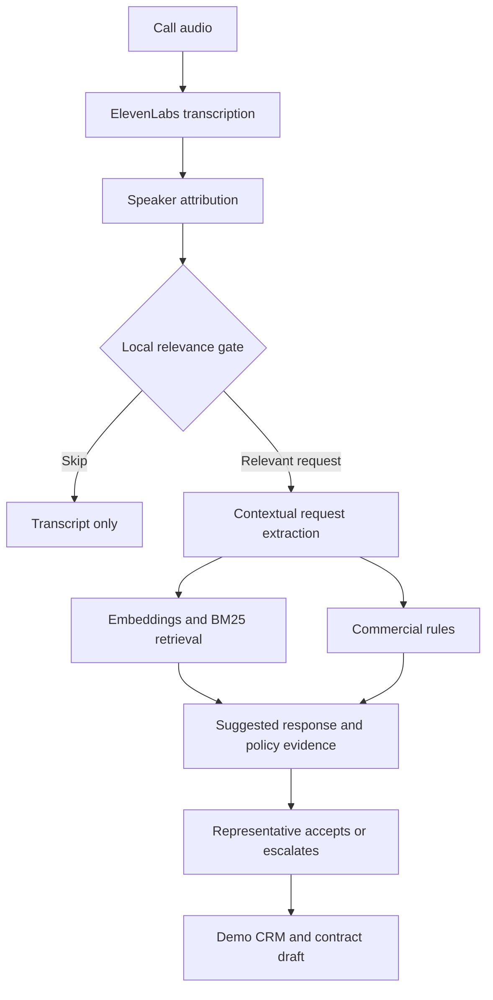

# CLOSER
### Live sales answers grounded in company policy

**Top 8 finalist** at the Future of Work Hackathon: Building from the Farm, hosted at Stanford University on October 9–10, 2026.

CLOSER is a live AI sales copilot that helps representatives answer pricing, contract, and product questions during a call. It retrieves supporting company information, applies commercial approval rules, and suggests a response while the human leads the conversation.

[Live app](https://closer-stanford-hack.replit.app/) · [Demo video](https://drive.google.com/file/d/1GAivhtHIVBHeEsfU7xI63K0ttm45Vp_t/view?usp=sharing) · [Presentation](https://docs.google.com/presentation/d/1OGUwgM_Jkfj1gyu0GmQol709y0xLPiwS/edit?usp=sharing) · [Project materials](https://drive.google.com/drive/folders/1MhbAmyQwKtMMFPvZ6TkTdU3sfCU3M8ih?usp=sharing)

## Why we built it

A customer asks for a discount, a security commitment, or different payment terms. The representative needs information from finance, legal, or product teams before answering confidently.

CLOSER brings those documents and approval boundaries into the call. The goal is to reduce avoidable follow-ups and help representatives respond with evidence. Business impact has not yet been measured in customer pilots.

Built for **Track 4: Sales Without “Let Me Get Back to You”**, which challenged teams to connect live voice, a searchable Company Brain, bounded negotiation, and deal updates.

## What the product does

- Transcribes live call audio and helps distinguish the customer from the representative.
- Filters irrelevant conversation before request extraction and retrieval.
- Combines semantic search with keyword search across company documents.
- Shows policy evidence, a recommendation, and suggested wording.
- Applies structured rules to return an approved option, counteroffer, or escalation requirement.
- Updates the demo CRM and contract draft when the representative accepts a card.
- Generates a post-call summary and displays API usage and timing details.

### Example conversation

The demo uses fictional seller **Nimbus Analytics** and customer **Acme Health**.

| Customer request | CLOSER response |
| --- | --- |
| “Can you offer 20% off for three years?” | Suggests the pre-approved 15% alternative and shows the discount policy. |
| “Do you sign a HIPAA BAA?” | Retrieves the Enterprise policy and supporting passage. |
| “Can we have Net 60?” | Checks the deal against the payment-term rule. |
| “What about Net 90?” | Identifies the Finance approval requirement. |

Accepting the 15% counteroffer on a $150,000 annual list price updates the annual fee to $127,500 and shows the corresponding contract changes. These are fictional demo policies, not claims about CLOSER's compliance status.

## Architecture



The FastAPI backend serves the built React interface, REST endpoints, and WebSockets on one port. The hackathon deployment runs on Replit.

### Engineering choices

**Speech and speaker attribution are separate.** ElevenLabs provides transcription. In single-microphone mode, local WeSpeaker ResNet34 embeddings through sherpa-onnx support online voice clustering. Calibration, contextual cues, and manual corrections help map voices to customer or representative. In call-tab mode, tab audio and microphone input provide separate role-labeled sources.

**Retrieval combines meaning with exact terms.** Nebius embeddings support paraphrases; BM25 helps match terms such as “Net 60” and “BAA.” Retrieval operates at sentence level and returns supporting passages.

**Commercial limits come from structured rules.** The rules engine evaluates negotiable requests against `rules.json`. The language model interprets requests and writes responses using the verdict and retrieved evidence. Knowledge questions use document evidence.

**The representative controls deal changes.** The interface provides Accept and Escalate actions. Accept changes the demo deal and contract draft; escalation displays the required approver.

**The local gate limits unnecessary inference.** Greetings and irrelevant turns can avoid downstream language-model and query-embedding calls. Live transcription still uses an API, and local processing still consumes compute.

### Technology

| Component | Technology |
| --- | --- |
| Backend and live events | Python, FastAPI, WebSockets |
| Frontend | React, Vite |
| Contextual extraction, response generation, summaries | Nebius Token Factory via the OpenAI SDK |
| Language model default | `openai/gpt-oss-120b` |
| Semantic retrieval | Nebius embeddings; embedding model selected from available models |
| Keyword retrieval | BM25 |
| Voice transcription | ElevenLabs Scribe v2 Realtime, with batch fallback |
| Local voice embeddings | WeSpeaker ResNet34, sherpa-onnx |
| Demo deal storage | SQLite |
| Development and hosting | Replit |

### Company Brain and storage

The repository includes 25 Markdown documents in `backend/brain/docs/` covering pricing, payment terms, security, integrations, product capabilities, contract terms, and sales objections.

At startup, the backend splits documents into paragraphs and sentences, builds the BM25 index, and requests document embeddings when Nebius is configured. Normalized vectors are stored in a NumPy array in backend memory. Nebius generates the embeddings; it does not store this application's vector index.

If embeddings are unavailable, retrieval falls back to BM25. Commercial rules live in `backend/brain/rules.json`. Deal data uses SQLite.

## Run locally

You need Python 3.10 or later, Node.js with npm, and provider credentials for live voice and AI features.

### 1. Clone and configure

```bash
git clone https://github.com/candelatesla/StanfordHack.git
cd StanfordHack
cp .env.example .env
```

Add `NEBIUS_API_KEY` and `ELEVENLABS_API_KEY` to `.env`. Keep credentials out of source control. Without keys, the app supports a reduced rules-based text mode.

Optional settings in `.env.example` include `FAST_MODEL`, `SMART_MODEL`, `EMBED_MODEL`, `NEBIUS_BASE_URL`, `STT_MODE`, and `TTS_VOICE_ID`. Model availability depends on your account.

### 2. Start the backend

macOS/Linux:

```bash
python3 -m venv backend/.venv
source backend/.venv/bin/activate
python -m pip install -r backend/requirements.txt
python tools/get_voice_model.py
cd backend
python -m uvicorn main:app --reload --port 8000
```

Windows PowerShell, from the repository root:

```powershell
py -m venv backend/.venv
.\backend\.venv\Scripts\Activate.ps1
python -m pip install -r backend/requirements.txt
python tools/get_voice_model.py
cd backend
python -m uvicorn main:app --reload --port 8000
```

The voice-model download is needed for local voice embeddings.

### 3. Start the frontend

In a second terminal, from the repository root:

```bash
cd frontend
npm install
npm run dev
```

Open `http://localhost:5173`. Backend health is available at `http://localhost:8000/api/health`.

### Single-port deployment

With Python, Node.js, and npm available:

```bash
bash start.sh
```

This installs dependencies, builds the frontend, downloads the voice model, and starts FastAPI. It uses `PORT` when provided, otherwise port 8000.

## Try the demo

1. Open the app and select a customer account.
2. Choose **Single mic** for an in-person conversation, or **Call tab + mic** for a browser call.
3. In single-mic mode, calibrate the representative's voice. Speaker labels can be corrected.
4. In call-tab mode, share the call tab's audio and use headphones to reduce echo.
5. Ask about a discount, BAA, or payment terms.
6. Review the recommendation and evidence before accepting or escalating.
7. Inspect the deal and contract diff, then end the call for a summary.

Typed input provides an alternative to microphone input. The `/customer` page contains a scripted customer soundboard. Browser audio capture requires appropriate permissions and a supported secure context, such as localhost or HTTPS.

## Evaluation

From `backend/`, with the backend virtual environment active:

```bash
python test_golden.py
python test_trigger.py
python test_retrieval.py
python eval_conversations.py
```

| Script | Purpose | Requirements |
| --- | --- | --- |
| `test_golden.py` | Demo flow, split sentences, multiple requests, speaker corrections | No provider keys |
| `test_trigger.py` | Request extraction and wording-based role cues | No provider keys |
| `test_retrieval.py` | Retrieval for paraphrased questions | Nebius key for hybrid mode |
| `eval_conversations.py` | Gate, retrieval, and rule evaluation over sample calls | Nebius key for hybrid mode |

From the repository root, with the same virtual environment active:

```bash
python tools/check_keys.py
python tools/test_audio.py --calibrate
```

The audio test requires provider keys and a running backend. It uses two ElevenLabs voices in one audio stream to exercise the speech pipeline.

These scripts are evaluation tooling, not a claim of production accuracy. Retrieval, first-token, and complete response timings have different measurement boundaries. The hackathon's sub-500ms retrieval target should not be interpreted as a demonstrated end-to-end guarantee.

## Prototype status

CLOSER is a hackathon prototype with a working demo workflow.

- The current backend uses shared in-process call state. Independent concurrent calls and tenants require isolation.
- The CRM is local demo storage, not a Salesforce or HubSpot integration.
- Startup reseeds the demo CRM through `crm.init(reset=True)`; do not rely on it for durable business records.
- Contract changes are draft updates, not signed agreements.
- Voice attribution and generated responses can be incorrect and need representative review.
- Authentication, access controls, retention settings, and production load testing remain future work.

Next steps include customer pilots, isolated call sessions, managed persistence, versioned policy indexes, and controlled CRM connectors.

## Team

Built by **Yash Chetan Doshi**, **Ritik Ashok Manghani**, and **Sarvesh Shirude**.

**Recognition:** Top 8 finalist, Future of Work Hackathon: Building from the Farm, Stanford University, October 2026.
